<div align="center">
  
</div>

<p align="center">
  <a href="https://jatinsh.netlify.app/"></a>
  <a href="https://jatinsh.netlify.app/resume.pdf"></a>
  <a href="https://linkedin.com/in/raghav1924"></a>
  <a href="https://api.whatsapp.com/send?phone=919368558623&text=Hi%20Jatin%2C%20reaching%20out%20from%20your%20GitHub%20profile%21"></a>
  <a href="mailto:raghavjatin245@gmail.com"></a>
</p>

<p align="center">
  <a href="https://leetcode.com/u/raghav1924/"></a>
  <a href="https://www.hackerrank.com/profile/raghav1924"></a>
  <a href="https://medium.com/@raghavjatin245"></a>
  <a href="https://bsky.app/profile/raghav1924.bsky.social"></a>
  <a href="https://github.com/raghav1924?tab=followers"></a>
  
</p>

<br/>



<br/><br/>


<table border="0" cellspacing="0" cellpadding="0">
<tr>
<td valign="middle" width="58%" style="border:none;">

- 🔭 **Now:** Building hospitality & AI tooling platforms with Next.js, Node.js and Azure
- 🧩 **DSA:** grinding **NeetCode 150 in Java**
- 💼 **Before:** Cogitate Technology Solutions (Mumbai) — cut client onboarding from **7–8 months to minutes**
- 🎯 **Open to:** SDE-2 / Senior Full Stack / Product Engineer — remote-global, visa sponsorship (🇺🇸 🇬🇧 🇨🇦 🇦🇺)
- 🎓 **Education:** PG Full Stack Engineering · NIIT StackRoute | B.Tech · AKTU
- ⏱️ **Availability:** immediate joiner
- ⚡ **Fun fact:** went 0 → production in 6 weeks. Twice.

</td>
<td valign="middle" width="42%" style="border:none;" align="center">
  
</td>
</tr>
</table>

> I'm a **Full Stack Software Engineer** with **3+ years of enterprise experience** building scalable, cloud-native web systems, event-driven APIs and reusable UI architectures with **React.js, Next.js, Node.js, TypeScript and Microsoft Azure**.
>
> I work with a **product engineering mindset** — across serverless architectures, REST/GraphQL APIs, authentication workflows and cloud systems, contributing to CI/CD and DevOps workflows to ship reliable, production-ready software.

<details>
<summary><b>▸ Press to expand: <code>const jatin = {…}</code></b></summary>

```ts
const jatin = {
  title        : "Full Stack Software Engineer",
  location     : "Mumbai, India 🇮🇳",
  experience   : "3+ years (Enterprise SaaS & Cloud)",
  languages    : ["JavaScript", "TypeScript", "Java", "Python", "SQL"],
  stack        : ["React.js", "Next.js", "Node.js", "Express.js", "GraphQL", "Spring Boot"],
  cloud        : ["Azure Functions", "Azure Cosmos DB", "Azure Blob", "Azure SQL", "Docker", "Kubernetes (AKS)"],
  domains      : ["Enterprise SaaS", "InsurTech", "AI Tooling", "Micro-Frontends", "Hospitality Tech"],
  keyMetrics   : {
    clientOnboarding : "7–8 months → <30 mins  (−99%)",
    featureDelivery  : "40–70% faster via reusable UI systems",
    docThroughput    : "+30% policy generation efficiency",
    brdAutomation    : "~70% less manual engineering effort",
  },
  openTo       : ["SDE-2", "Senior FSE", "Product Engineer", "Remote-Global", "Visa Sponsorship"],
  targets      : ["🇺🇸 US", "🇬🇧 UK", "🇨🇦 Canada", "🇦🇺 Australia"],
  education    : ["PG Full Stack Engineering — NIIT StackRoute (2023)", "B.Tech Chemical Engg — AKTU (2022)"],
  availability : "Immediate joiner",
  funFact      : "Went 0 → production in 6 weeks. Twice.",
};
```

</details>

<br/>




<br/>


<p align="center">
  <a href="https://www.comfortnstay.com/"></a>
  <a href="https://trydraftly.netlify.app/"></a>
  <a href="https://graphqlutility.netlify.app/"></a>
</p>

<p align="center"><sub>Click a card to open the live app · <a href="https://jatinsh.netlify.app/">see all projects on my portfolio →</a></sub></p>

<br/>




<br/>


<p align="center">
  
</p>

<p align="center">
  <a href="https://leetcode.com/u/raghav1924/"></a>
</p>

> 📌 Grinding **NeetCode 150** — Arrays · Two Pointers · Sliding Window · Trees · Graphs · DP &nbsp;|&nbsp; Language: **Java**

<br/>




<br/>


<p align="center">
  <a href="https://jatinsh.netlify.app/">Portfolio</a> &nbsp;·&nbsp;
  <a href="https://jatinsh.netlify.app/resume.pdf">Resume</a> &nbsp;·&nbsp;
  <a href="https://api.whatsapp.com/send?phone=919368558623&text=Hi%20Jatin%2C%20reaching%20out%20from%20your%20GitHub%20profile%21">WhatsApp</a> &nbsp;·&nbsp;
  <a href="mailto:raghavjatin245@gmail.com">Email</a>
</p>
