<div align="center">
  
</div>

<p align="center">
  <a href="https://linkedin.com/in/raghav1924"></a>
  <a href="https://raghav1924.netlify.app"></a>
  <a href="https://leetcode.com/raghav1924"></a>
  <a href="https://github.com/raghav1924"></a>
  <a href="mailto:raghavjatin245@gmail.com"></a>
  
</p>

<br/>


<br/><br/>


<table border="0" cellspacing="0" cellpadding="0">
<tr>
<td valign="middle" width="55%" style="border:none;">

- 🌱 Grinding **DSA (NeetCode 150) in Java** and building with **Azure OpenAI**
- 💬 Ask me about **React, Next.js, TypeScript, Node.js, GraphQL, Azure, Micro-frontends, Spring Boot**
- 🎯 Open to **SDE-2 / Senior FSE** — remote-global, visa sponsorship (🇺🇸 🇬🇧 🇨🇦 🇦🇺)
- 📫 Reach me at **raghavjatin245@gmail.com**
- ⚡ Fun fact: **went 0 → production in 6 weeks. Twice.**

</td>
<td valign="middle" width="45%" style="border:none;" align="center">
  
</td>
</tr>
</table>

> I'm a **Full Stack Engineer** focused on product systems and scalable architectures — building high-performance applications, APIs, and cloud-native systems using JavaScript, TypeScript, Node.js, GraphQL, and Azure.
>
> I operate with a **product engineering mindset** — working across serverless architectures, APIs, and cloud systems, while contributing to deployment and DevOps workflows to ship reliable, production-ready solutions.

<details>
<summary><b>▸ Press to expand: <code>const jatin = {…}</code></b></summary>

```ts
const jatin = {
  title       : "Full Stack + Product Engineer",
  location    : "Mumbai, India 🇮🇳",
  experience  : "~3 years",
  stack       : ["React", "Next.js", "TypeScript", "Node.js", "GraphQL", "Azure"],
  domains     : ["Enterprise SaaS", "Insurance Tech", "AI Tooling", "Micro-Frontends"],
  openTo      : ["SDE-2", "Senior FSE", "Remote-Global", "Visa Sponsorship"],
  targets     : ["🇺🇸 US", "🇬🇧 UK", "🇨🇦 Canada", "🇦🇺 Australia"],
  funFact     : "Went 0 → production in 6 weeks. Twice.",
};
```

</details>

<br/>


<br/>


<br/>


<p align="center">
  
  
</p>

<p align="center">
  
</p>

<p align="center">
  
</p>

<p align="center">
  
</p>

> 📌 Grinding **NeetCode 150** — Arrays · Trees · Graphs · DP &nbsp;|&nbsp; Language: **Java**

<br/>


<br/>


